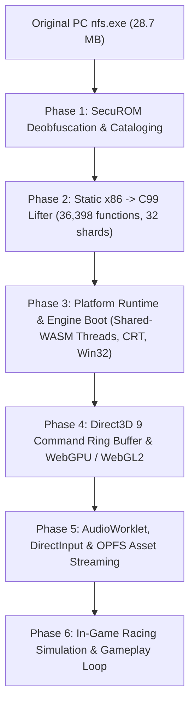

# PortStreet (formerly PortSpeed)

> **Experimental native browser port of Need for Speed: ProStreet (PC v1.1, 2007) via static x86 Ahead-Of-Time recompilation and WebAssembly.**

---

## Legal & Research Disclaimer

**PortStreet is an independent reverse-engineering, binary translation, and digital preservation research project.**
- This project is **not** affiliated with, sponsored by, or endorsed by Electronic Arts, EA Black Box, or their licensors.
- "Need for Speed" and "Need for Speed: ProStreet" are trademarks of Electronic Arts Inc.
- **No copyrighted game assets, proprietary game executables, or original binary assets are distributed in this repository.** Users must supply their own legally purchased copy of *Need for Speed: ProStreet* (PC v1.1, `nfs.exe`).

---

## Architectural Foundation: Static AOT Binary Recompilation

PortStreet translates the original 2007 Windows x86 game code to modern web browsers via **Ahead-Of-Time (AOT) static binary recompilation** rather than instruction-by-instruction emulation or building a reimplemented racing clone:



1. **Static Ahead-Of-Time Lifter:** 36,398 authentic x86 functions cataloged and lifted into 32 modular C99 translation units (`gen/shard_0000.c` .. `gen/shard_0031.c`) with WebAssembly SIMD128 intrinsics, 80-bit precision x87 circular stack emulation, and bit-parallel arithmetic flag computation (`FLAGS_ADC_M`, `FLAGS_SBB_M`, `FLAGS_LOG_M`).
2. **1:1 Guest Linear Memory Layout:** 704 MB shared WebAssembly linear memory (`IMAGE_BASE=0`, `0x00000000..0x2c000000`). Guest virtual addresses map directly to linear memory offsets without pointer translation overhead.
3. **Master Dispatch Table (`g_dtab`):** Direct $O(1)$ function pointer array of 5,660,672 entries covering `0x00401000..0x00967000`, resolving direct and indirect dispatches at native speed.
4. **Shared-WASM Threading & Control Mailbox:** Up to 8 guest worker threads instantiate the identical WebAssembly module with imported shared memory. Per-worker C shadow stacks are strictly isolated in high linear memory (`0x2b000000..0x2c000000`, 2 MB each). Worker thread synchronization and scheduling operate via a dedicated Shared Control Mailbox (`0x00107000`) and native WebAssembly atomics (`memory.atomic.wait32` / `memory.atomic.notify`).
5. **Clean CRT & Win32 Shim Layer:** Dynamic `MSVCR80.dll` IAT imports (156 functions) and Win32 imports (198 functions) shimmed in clean C99.
6. **Zero Remake / Authentic Scope:** PortStreet executes genuine game machine code. No synthetic tracks, placeholder vehicles, or hardcoded game loops exist.

---

## Current Engineering Status & Verified Reality

> [!WARNING]
> **Authenticity & Playability Status**:
> - **The game is NOT yet playable in the browser.**
> - **Original 3D world rendering, menus, and visual gameplay frames are NOT yet produced.**
> - **Zero authentic rendered frames have been output to the screen (`sub_006dae50` not yet reached).**
> - The production WebAssembly binary [`build/game.wasm`](file:///c:/Users/tabat/OneDrive/Desktop/NFS-PortStreet-Project/build/game.wasm) (**62.37 MB**, 65,397,285 bytes) builds cleanly with atomics and shared memory.
> - **Regression Tests:** All **348 / 348 unit and integration tests are passing (100% green)**.
> - **Static C++ Initializers:** All **960 / 960 initializers** execute to completion with 0 unresolved dispatches.
> - **Concurrency Breakthrough:** **Six authentic guest threads** are created, synchronized, and executed concurrently:
>   - Worker 0: **45,755 authentic dispatches**, active in task servicing and window messaging.
>   - Worker 1: 6 dispatches, successfully executed streaming handshake (`sub_008976e4 -> SetEvent`).
>   - Workers 2, 3, 4: Genuinely executed C++ runnable tasks via newly recovered `sub_009058d0`.
>   - Worker 5: Initialized and entered execution loop `sub_00909550`.
> - **Task Pool Completion:** The 32-slot engine task pool at `0x00b44e00` completed genuinely, allowing the main engine thread to exit `sub_00904d00` and return from `sub_0090d910`.
> - **Historic Checkpoint Reached:** Main execution advanced past `sub_006dba80` (Engine Main Loop) into **`sub_006daa70` (Engine Startup Phase)**, executing **344,373 dispatches on the Main Thread** and over **390,191 dispatches engine-wide** before halting on uncataloged routines.

---

## Detailed Milestone Status: Implemented vs. Pending

| Subsystem / Feature | Status | Verification & Evidence |
| :--- | :--- | :--- |
| **SecuROM Deobfuscation** | **IMPLEMENTED & VERIFIED** | 220 `.text` + 294 `.securom` countdown stubs neutralized; 2,153 indirect trampolines resolved; stolen prologues recovered. |
| **x86 to C99 Instruction Lifter** | **IMPLEMENTED & VERIFIED** | 36,398 functions lifted across 32 shards; SIMD128, 80-bit x87 FPU, atomic `lock xadd`/`cmpxchg`, bit-parallel flags, `POPFD` flag-isolation fix (`LR_RELOAD_FLAGS`). |
| **Master Dispatch Table (`g_dtab`)** | **IMPLEMENTED & VERIFIED** | Direct $O(1)$ table covering `0x00401000..0x00967000` (5.6M entries); initialized in 3 ms. |
| **C++ Static Initializers (`_initterm`)** | **IMPLEMENTED & VERIFIED** | All **960 / 960** initializers execute to completion in 293 ms with 0 unresolved dispatches. Constructor #169 verified. |
| **Authentic `main()` Entry** | **IMPLEMENTED & VERIFIED** | `sub_004afee0` entered with valid Win32 arguments; root subsystems initialized (`sub_0090c8d0` obj=`0x22322f0`). |
| **Multi-Worker WASM Concurrency** | **IMPLEMENTED & VERIFIED** | Up to 8 Web Workers running with imported shared memory; C shadow stacks isolated in `0x2b000000..0x2c000000`; 6 authentic guest threads scheduled concurrently. |
| **Shared Control Mailbox (`0x00107000`)** | **IMPLEMENTED & VERIFIED** | Atomics-based command wait/notify; decoupled from Node.js event-loop message starvation. |
| **Authentic Worker Handshake** | **IMPLEMENTED & VERIFIED** | Worker Slot 1 executes authentic `sub_008976e4`, writes acknowledgment `[arglist]=1`, and enters `sub_008991ac` queue wait. |
| **Engine Task Pool Synchronization** | **IMPLEMENTED & VERIFIED** | Workers 2, 3, 4 executed tasks via companion entrypoint `sub_009058d0`; `sub_00904d00` wait loop exited naturally. |
| **Engine Main Loop (`sub_006dba80`)** | **IMPLEMENTED & VERIFIED** | Entered main loop and progressed deep into startup phase. |
| **Engine Startup Phase (`sub_006daa70`)** | **PARTIALLY WORKING** | Entered `sub_006daa70`; executed call chain through `sub_007ca900` -> `sub_007c06e0` -> `sub_0084a560` -> `sub_00853e80` -> `sub_00851370` -> `sub_00848560` -> `sub_00846de0`. |
| **Uncataloged CRT & Memory Routines** | **ACTIVE BLOCKER** | Unresolved indirect calls to `0x0082dce0` (CRT unlock/free wrapper), `0x007b24f0` (BChunk memory pool allocator), and `0x00701250` (PeekMessage loop). |
| **Direct3D 9 COM Shims & Ring Buffer** | **TESTED IN ISOLATION** | D3D9 vtables, 64-byte command ring buffer (`0x27810000`), 34 D3DX effects parsed, 597 shaders cataloged. |
| **WebGL2 / WebGPU Host Consumer** | **TESTED IN ISOLATION** | Command processor (`web/src/d3d9_consumer.ts`) with draw calls and state mapping; 19 TypeScript unit tests passing. |
| **DirectInput8 & AudioWorklet** | **TESTED IN ISOLATION** | DirectInput COM vtables, mobile touch overlay, AudioWorklet PCM circular stream verified in isolated harnesses. |
| **OPFS Chunk Asset Streaming** | **TESTED IN ISOLATION** | OPFS streaming worker for 5.6 GB game assets with 1 MiB chunk caching. |
| **First Authentic Rendered Frame** | **NOT YET IMPLEMENTED** | Blocked by missing routines in `sub_006daa70` before reaching `sub_006dae50` / D3D9 present. |
| **Authentic Racing Gameplay** | **NOT YET IMPLEMENTED** | Engine boot must complete before in-game Havok physics, AI, and race tracks activate. |

---

## Technical Architecture Deep Dive

### 1. Memory Space Layout (704 MB Shared Linear Memory)

```
0x00000000 - 0x00100000 : Null-page guard (1 MB)
0x00100000 - 0x00102000 : Main Thread TEB & SEH chain
0x00102000 - 0x00104000 : Main Thread .tls private template copy
0x00104000 - 0x00105000 : Main CPU register structure
0x00105000 - 0x00107000 : Worker CPU register structures (8 x 1 KiB)
0x00107000 - 0x00108000 : Shared Worker Control Mailbox (8 slots x 32 bytes)
0x00108000 - 0x00110000 : Worker TEB blocks (8 x 4 KiB)
0x00110000 - 0x00118000 : Worker .tls copies (8 x 4 KiB)
0x00140000 - 0x00200000 : Worker x86 guest stacks (8 x 96 KiB)
0x00200000 - 0x00400000 : Main x86 guest stack (2 MB, ESP starts at 0x003FF000)
0x00400000 - 0x010ea000 : Authentic PE sections (.text, .rdata, .data, .tls, .rsrc, ars, est, artem, celare)
0x019b1000 - 0x01f687e2 : Authentic .securom code segment
0x02000000 - 0x27800000 : Dynamic Guest Heap (up to 600 MB)
0x27800000 - 0x28000000 : Dedicated D3D9 Command Ring Buffer (8 MB)
0x28000000 - 0x2a000000 : WASM C Heap & Dispatch Table (g_dtab at 0x28014c70)
0x2b000000 - 0x2c000000 : Isolated Worker WASM C Shadow Stacks (0x2c000000 - slot * 2 MB)
```

### 2. Multi-Worker Shared WASM Concurrency

The PC release of *Need for Speed: ProStreet* relies heavily on background threads created via `_beginthreadex` for asynchronous asset decompression, task dispatching, and persistent streaming queue processing.

To faithfully support this in WebAssembly:
- Secondary Web Workers instantiate `game.wasm` sharing `env.memory`.
- **C Shadow Stack Isolation:** Clang/LLVM WebAssembly binaries maintain a mutable shadow stack pointer `__stack_pointer`. PortSpeed isolates each worker's `__stack_pointer` to `0x2c000000 - slot * 0x00200000`, preventing corruption of the main thread's spilled frame registers.
- **Shared Control Mailbox:** Because Node.js and browser `postMessage` event queues are starved when the main thread executes synchronous WASM, workers communicate via atomic futexes in linear memory. Workers immediately enter `guest_worker_slot_run` upon startup and wait on `memory.atomic.wait32`. `ResumeThread` executes `memory.atomic.notify`, achieving instantaneous thread activation.
- **Worker Pool Synchronization:** Main thread schedules work items across a 32-slot task pool (`0x00b44e00`). Worker threads 2, 3, and 4 enter `sub_009058d0`, invoke C++ runnable vtables, decrement completion counters, and unblock `sub_00904d00`.

---

## Development & Verification Commands

All commands are run from the project root:

```powershell
# 1. Run complete unit and regression test suite (348 tests, 100% green)
python -m unittest discover -s tests -v

# 2. Run multi-worker scheduler integration test (verifies dual worker concurrency and authentic handshake)
node --experimental-wasi-unstable-preview1 tests/test_multi_worker_scheduler.mjs

# 3. Execute single supervised authentic full-game startup diagnostic (35-second hard timeout supervisor)
python tools/run_diagnostic_timeout.py --timeout 35.0

# 4. Compile production game.wasm binary (incremental content-hashed build)
python tools/build_wasm.py --game
```

---

## Active Blockers & Next Milestones

1. **Recovery of Missing Startup Routines:**
   - `0x0082dce0`: CRT lock/unlock wrapper (`mov eax, [esp+4]; push eax; call sub_00828584; add esp, 4; ret`), called 20 times during startup.
   - `0x007b24f0`: BChunk memory pool allocator wrapper (calls `sub_00435e90`).
   - `0x00701250`: Window message polling helper (`PeekMessageA` via `0x00967474`), called 15,193 times by Worker 0.
   - `0x0070e480`: Worker 0 subsystem initialization helper.
2. **Phase 4 — First Authentic Engine Frame (`sub_006dae50`):**
   - Advance through startup phase `sub_006daa70` into `sub_006d2df0` and the authentic frame tick `sub_006dae50`.
   - Verify serialization of the first `D3D9_CMD_PRESENT` packet into the shared memory ring buffer (`0x27810000`).
3. **Phase 4.3 — TypeScript GPU Host Consumer & First Visible Output:**
   - Connect the Web Worker host to the browser WebGL2 canvas and render the first authentic engine frame.
